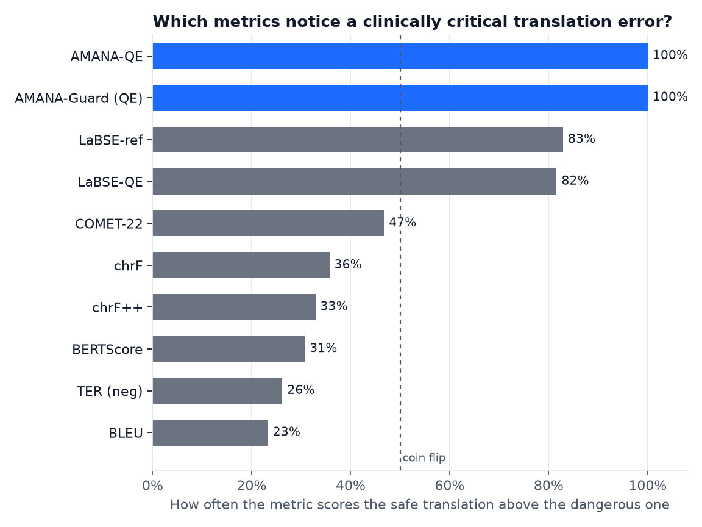
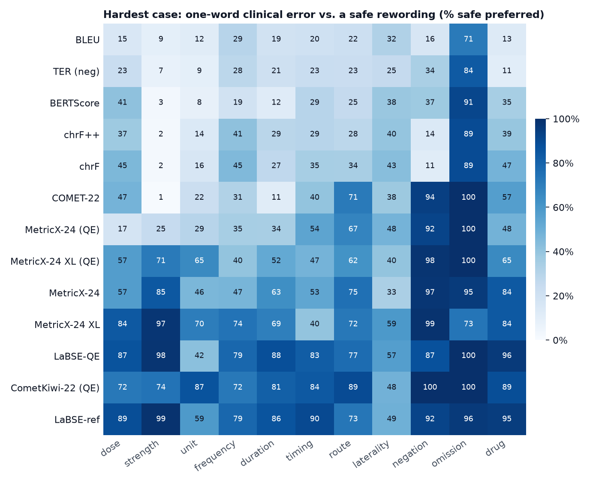
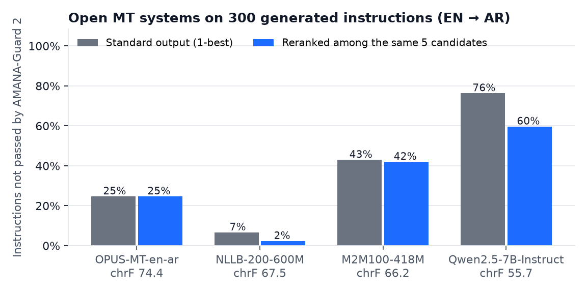

# AMANA (أمانة): clinical meaning preservation in English → Arabic medication translation

[](https://doi.org/10.5281/zenodo.23989821)

*Amana* means faithfulness to what you were entrusted with.

A translated medication instruction can be fluent, get a strong MT score, and still tell the patient
to take **25 mg instead of 25 mcg**, or to put drops in the **right** eye instead of the left. AMANA
is a research framework for measuring this. It is **not a clinically validated safety system**.

On Hugging Face: the benchmark, [momen-ibrahim/amana-bench](https://huggingface.co/datasets/momen-ibrahim/amana-bench),
and the learned scorer, [momen-ibrahim/amana-qe](https://huggingface.co/momen-ibrahim/amana-qe).

The most useful result here is a gap, not a high score. The checkers look excellent on the benchmark
they were built with, and much weaker as the test moves away from it:

| evaluation track | what is new to the checker | AMANA-Guard 2 | AMANA-QE |
|---|---|---|---|
| Held-out drugs (AMANA-Bench) | the drug only; same templates | recall 100%, false alarms 0% *(upper bound)* | AUROC 0.999; a classifier that never sees the English reaches 0.711 |
| Unseen dosage forms | eye drops, inhalers | not applicable (rules) | AUROC 0.85–0.86; false alarms 70–100% at 0.5 (5 seeds) |
| Unseen error types | unit, laterality, negation | not applicable (rules) | AUROC 0.66–0.73; recall 7–36% at 0.5 (5 seeds) |
| Real text, controlled errors (AMANA-TICO) | the wording; errors are still injected | recall 95.7%, false alarms 25.5% *(development data; sentences with nothing to compare count as not checked)* | AUROC 0.80; false alarms 70% at 0.5 |
| Hand-written hold-out (n = 40) | the phrasing | 20/20 errors, 15/20 safe *(same author, not blind; first run 19/20, 14/20)* | not run |
| An outside reviewer's probes (n = 41) | cases written by someone else, who had read the code | first run: **10/30 errors caught**, 8/11 safe accepted; after the fixes they led to, 30/30 and 9/11 *(now fitted)* | not run |
| Drug names from Wikidata (sealed, n = 366) | names no one here chose | accepts 94.0% of correct names, 3.3% of the most similar wrong drug | not applicable |
| Real FDA label sentences, MT output (sealed half) | real English; **no error labels** | passes 30–33%, flags 11–15%, sends 54–58% to review | not run |
| Real human leaflets, PEACH (sealed half) | real English and Arabic; errors injected | catches 95–100% of injected errors, but only about 1 in 6 flags on the published text points at a real difference | not run |
| Human review of reranking (n = 60, one rater) | a person, not the checker, judges | reranking better in 5, worse in 4, same in 51: no evidence either way *(not truly blinded; qualification not recorded)* | part of the reranked pick |
| Naturally occurring errors, independently annotated | everything | **not done** | **not done** |

AMANA-QE was not tested on the hand-written cases. Its unseen-type and unseen-form rows use five seeds each (13–17).

**Version 0.5 corrects claims made in 0.4.** An outside review, reproduced here, found that:

- the checker reported sentences it never checked as fully covered;
- the metric finding was inflated by scoring Arabic without standard normalisation;
- the benchmark's labels can be read from the Arabic alone;
- the human review could be unblinded from public files;
- 20 of 30 new dangerous translations passed.

Each point is addressed below, with the numbers before and after.

## Key findings

**1. When a safe translation is worded differently from the reference, standard metrics often prefer
a one-word clinical error, though much of the raw gap comes from scoring unnormalised Arabic.** The "reworded"
test pairs a safe rewording with the reference plus one clinical error. The "same wording" test applies the error to
the safe rewording itself. There are 1,620 pairs on 13 held-out drugs, covering 11 error types. Intervals resample the
13 drugs, since pairs from one drug share templates.

| metric | safe preferred: reworded, raw (95% CI) | reworded, Arabic normalised | reworded, 10× strength errors only (raw) | safe preferred: same wording, raw (95% CI) |
|---|---:|---:|---:|---:|
| BLEU | 23.3% (19.9–27.2) | 40.1% | 9% | 94.2% (93.1–95.3) |
| TER | 26.2% (23.7–28.6) | 39.6% | 7% | 93.3% (92.1–94.6) |
| BERTScore | 30.7% (27.8–34.5) | 45.4% | 3% | 95.6% (94.3–96.9) |
| chrF++ | 32.9% (29.4–37.0) | 49.9% | 2% | 98.6% (97.9–99.2) |
| chrF | 35.7% (31.5–40.3) | 51.6% | 2% | 98.6% (97.9–99.2) |
| COMET-22 | 46.7% (42.9–50.5) | 59.2% | **1%** | 94.6% (93.7–95.7) |
| LaBSE, reference | 82.9% (79.1–86.7) | 87.8% | 99% | 99.7% (99.3–100) |
| LaBSE, source only | 81.6% (77.8–85.8) | 84.6% | 98% | 97.2% (94.9–98.9) |
| CometKiwi-22, source only | 82.1% (76.5–86.8) | 81.5% | 74% | 90.4% (87.6–93.1) |
| MetricX-24, reference | 67.6% (63.6–71.9) | 71.7% | 85% | 95.9% (94.3–97.3) |
| MetricX-24, source only | 49.9% (46.3–54.6) | 56.4% | 25% | 78.9% (76.0–81.9) |
| MetricX-24 XL, reference | 75.0% (72.1–78.3) | 80.3% | 97% | 95.4% (93.9–96.8) |
| MetricX-24 XL, source only | 63.9% (59.2–68.6) | 68.8% | 71% | 81.4% (77.3–85.1) |

Ties count as half. They matter only for BLEU (5.4%) and TER (16.5%). So these metrics can see the
error: with the wording held equal, all but MetricX-24 without the reference (79–81%) catch it at least 90% of the time. The failure is one of
weighting, since a harmless rewording can cost more score than a tenfold dose change. The reworded
test is built to expose this, because the erroneous sentence is one word from the reference. It does
not estimate how metrics behave on natural MT output. Margins, ties, pair-level intervals and per-type results are in
`results/metric_stats.json`; the normalised scores are in `results/benchmark_controls.json`.

**The raw figures are inflated by a missing preprocessing step.** Of the 1,620 safe rewordings, 730 change the
spelling, such as Arabic-Indic digits or hamza-free spelling, and 159 change nothing else. Arabic MT evaluation usually
normalises these first, and the raw column does not. After `amana.arabic.normalize` (`scripts/18_benchmark_controls.py`),
every surface metric prefers the safe version in all 159 spelling-only pairs. On the 890 pairs that change only words,
BLEU, TER, chrF and chrF++ still prefer the error 58–70% of the time:

| safe preferred, normalised | spelling-only changes (n = 159) | word changes only (n = 890) |
|---|---:|---:|
| BLEU | 100% | 30.3% |
| TER | 100% | 30.3% |
| chrF++ | 100% | 40.1% |
| chrF | 100% | 42.0% |

The weighting problem is real for genuine rewording, but smaller than the raw table suggests. COMET-22 moves from a coin
flip to 59%. CometKiwi-22 does not move, since it never sees the reference. The learned metrics were scored raw and
normalised in one run, and that run reproduced every raw figure in the table exactly.

CometKiwi-22, the standard reference-free quality estimator, is among the least affected by rewording but the weakest
when the wording is held equal. Its blind spots are by error type: for a left/right eye swap it prefers the safe
version 48% of the time when reworded and 73% with the same wording, and for a tenfold strength error 74% and 85%.
It prefers the safe version every time when a warning is dropped or a negation removed.

MetricX-24 (hybrid, v2.6) improves with size: with the reference, the large checkpoint prefers the safe version 68% of
the time when reworded and the XL checkpoint 75%. Without the reference both stay weak, at 50% and 64%, and they are the
only metrics here that often miss the error even with the wording held equal (79% and 81%). For a wrong dose, the large
one prefers the error 60% of the time. Its scoring is re-implemented in `amana/metrics.py` from the published model, not
run through the official package. The XL checkpoint needs about 30 GB of GPU memory in float32, so it was scored on two
free Kaggle T4 GPUs, with newer libraries (torch 2.11, transformers 5.20); every other metric run in that environment
reproduced its committed figures exactly. xCOMET-XL (gated) and MetricX-24 XXL (13B parameters) were not run.



The heatmap breaks the reworded test down by error type.



**2. Open MT systems make these errors, and a high chrF does not rule them out.** Each system translated
300 instructions for held-out drugs. These inputs are generated, not real prescriptions, so this is an
exploratory audit, not an estimate of how often these models err on clinical text or a safety ranking.

| | OPUS-MT en-ar | NLLB-200-600M | M2M100-418M | Qwen2.5-7B-Instruct (LLM, 4-bit) |
|---|---:|---:|---:|---:|
| chrF / COMET-22 | **74.4** / 0.862 | 67.5 / **0.878** | 66.2 / 0.839 | 55.7 / 0.812 |
| not passed by AMANA-Guard 2 (95% CI) | 24.7% (20.1–29.8) | **6.7%** (4.4–10.1) | 43.0% (37.5–48.7) | 76.3% (71.2–80.8) |
| of which flagged / needs review only | 9.3% / 15.3% | 6.7% / 0% | 43.0% / 0% | 32.7% / 43.7% |
| "mcg" doses written as "mg" (1000×) | **18 / 18** | 0 / 18 | 2 / 18 | 0 / 18 |
| "rash" warning → "البراز" ("stool") | 0 / 46 | 0 / 46 | **40 / 46** | 0 / 46 |
| "rash" warning → "حكة" ("itch") | 0 / 46 | 0 / 46 | 0 / 46 | **44 / 46** |
| safety warnings silently dropped | 2 / 109 | 19 / 109 | **57 / 109** | 0 / 109 |
| glimepiride (diabetes) → "حبوب منع الحمل" (contraceptive pills) | 0 / 26 | 0 / 26 | **5 / 26** | 0 / 26 |
| "Instill" (eye drops) → "لا تزال" ("still") | **44 / 44** | 0 / 44 | 0 / 44 | 0 / 44 |
| "by mouth" → "من فم إلى فم" ("mouth to mouth") | 0 / 229 | 0 / 229 | 0 / 229 | **78 / 229** |
| "tablet" → "كبسولة" ("capsule") | 0 / 133 | 0 / 133 | 0 / 133 | **50 / 133** |
| drug name left in English letters | 0 / 300 | 33 / 300 | 0 / 300 | **71 / 300** |

The pattern rows are exact counts of each pattern in `results/mt_error_patterns.json`. They are not independent
errors: the 300 generated sources reuse a few sentences. All 46 "rash" rows share one warning sentence, so 40 of 46 is
one mistranslation repeated. All 18 "mcg" rows are levothyroxine, the 26 glimepiride rows are one drug, the 44 "Instill"
rows come from 2 drugs, and the dropped warnings come from 6 distinct warning sentences. The rates in the
second row are checker output, and no independent reviewer has adjudicated them. The first checker put
M2M100 at 21.3%. Guard 2 reports 43.0% mainly because it now checks what each warning says, not only
whether a warning is present. Most of that increase comes from warnings it can no longer find, such as
the "rash" sentence above.

The LLM column is one open model, Qwen2.5-7B-Instruct, with 4-bit weights to fit an 8 GB GPU, one fixed prompt and the
same 5-beam search. It avoids every pattern of the dedicated MT systems but has its own: "by mouth" as "mouth to
mouth", "tablet" as "capsule", "rash" as "itch", and drug names left in English letters (4 drugs). Guard 2 sends 43.7% to
review, mostly because it cannot find "by mouth" in the Arabic. Six of its 300 1-best outputs (30 of 1,500 candidates)
ran on into an invented next prompt; they were cut at the first line break, which leaves a broken fragment. 4-bit
weights can lower quality, so this is not a verdict on the model or on LLMs in general. Commercial systems and larger
LLMs are untested.

**3. Reranking helps only when a clean candidate exists, which here means mostly NLLB.** The checkers
choose among each system's own 5-best beam candidates, with no retraining.

| not passed by Guard 2 | 1-best | QE rerank (does not use the guard) | Guard 2 + QE rerank | all 5 candidates fail |
|---|---:|---:|---:|---:|
| NLLB-200-600M | 6.7% | 4.3% | **2.3%** | 7 / 300 |
| OPUS-MT en-ar | 24.7% | 27.0% | 24.7% | 74 / 300 |
| M2M100-418M | 43.0% | 42.3% | 42.0% | 126 / 300 |
| Qwen2.5-7B-Instruct | 76.3% | 71.3% | 59.7% | 179 / 300 |

Re-run with the 0.5 checker; only OPUS-MT's first two cells moved (from 25.0% and 27.3%), and 1 of 900 picks changed.
The Guard 2 + QE column is partly circular, because Guard 2 both chooses and judges. It shows that
candidates with a detected problem were avoided, not that the chosen output is safe. The QE column is
the fairer cross-check, and it makes OPUS-MT slightly worse. The reverse cross-check, the share AMANA-QE
scores below 0.5, moves little after Guard 2 + QE: NLLB 13.0% → 9.7%, OPUS-MT 27.7% → 26.3%, M2M100 21.7%
→ 20.3%. Changes in chrF stay within ±1.2 and in COMET-22 within ±0.003. For the LLM, Guard 2 + QE lowers the share not
passed from 76.3% to 59.7%, but QE alone only to 71.3%, and all 5 candidates fail for 179 of 300 instructions.

**A human review supports no conclusion.** One reviewer judged the 60 pairs in `adjudication/packet.html`, each
showing the 1-best and the Guard 2 + QE pick in random order. The packet is not truly blind: the 1-best version of all
60 pairs can be found in the public `results/mt_outputs.jsonl`. The reviewer's clinical qualification was not
recorded, and there was one rater, so no agreement can be measured. Reranking was judged better in 5 pairs, worse in 4
and the same in 51 (two-sided sign test p = 1.0). It removed 3 errors rated clinically critical and added 1. The
reviewer rated 9 OPUS-MT pairs critical in both versions because "tablet" became لوح, a word used for tablets in some
regions. Counts are in `results/adjudication.json`. The packet was built from the 0.4 picks (the `mt_picks.jsonl` of
commit 4412319). The one pick that changed in 0.5 is packet item 21: there, reranking now keeps the 1-best. The reviewer
had judged the two versions the same, so the totals do not change. A valid review needs a packet built from a private
seed and sent outside the repository, at least two qualified raters, and control pairs with known errors.



**4. On real patient text, the checker can verify far less, and it now says so.** The earlier findings use
generated instructions. Here, three MT systems translated 600 real sentences from US FDA patient labels. Labels
were split by hash into a development half, used to fix false alarms, and a sealed half, scored afterwards.

| sealed half, n = 300 per system (95% CI) | NLLB-200-600M | M2M100-418M | OPUS-MT en-ar |
|---|---:|---:|---:|
| no problem detected | 32.7% (27.6–38.2) | 30.3% (25.4–35.8) | 31.7% (26.7–37.1) |
| flagged | 13.7% (10.2–18.0) | 15.3% (11.7–19.8) | 10.7% (7.7–14.7) |
| needs review only | 53.7% (48.0–59.2) | 54.3% (48.7–59.9) | 57.7% (52.0–63.1) |
| a source digit missing from the output, no parser used | 39 | 15 | 24 |

These are not error rates: the sentences have no error labels and no one has judged the outputs. Only 51% of the
sealed sentences were fully covered by the rules, against every sentence on the benchmark, so that gap is the main
result. 31% of sentences contain no dosing instruction. For these the checker compares only numbers, negation, drug
names and the whole-text checks of finding 5, and 56–59% of all passes come from them. The digit count is an upper bound, since a dual such as "جرعتين" hides its number. The flags include real errors,
such as "20 mcg" as "20 ملغ", metformin as "حبوب منع الحمل" (contraceptive pills) and "Do not breastfeed" as "لا تلمس"
("do not touch"), and also false alarms.

**5. The checker passed what it could not check. Most of these gaps are now closed, and the rest are reported.** An outside
review found two problems:

- **The fallback path.** A source sentence with no recognisable dosing instruction went to a fallback comparison and was
  still reported as fully covered. On the sealed FDA half that was 94 of 300 sentences, and two thirds of all passes. Such
  a sentence now counts as not checked unless it has a number or a negation to compare. Each report also says whether
  this path was taken (`general_path` in the results).
- **New dangerous probes.** The reviewer wrote 41 probes (`data/review_probes.jsonl`, frozen by hash). On the first run
  (`results/review_probes_first_run.json`), **20 of 30 dangerous translations passed as `ok`**:
    - ".5 mg" read as 5 mg;
    - `ug`, `mg/kg` and `%` ignored;
    - "once weekly" against "three times weekly";
    - hours against minutes;
    - before against after breakfast, and bedtime against morning;
    - 20 against "خمسة وعشرين" (25);
    - a side named where the source names none;
    - swapped morning and evening insulin doses;
    - an added "you can double the dose";
    - water against milk;
    - a garbled drug name;
    - "breastfeeding" as "touching".

  3 of 11 faithful translations were also mis-read.

All 30 are now caught and the 3 mis-readings fixed; these probes are now fitted, so they are regression tests, not
evidence. Two safe sentences, "Shake the bottle well" and "Tell your doctor if you are pregnant", have nothing the rules
can compare and are reported as not checked. Earlier probes by the author had found a wrong drug passing (apixaban as
rivaroxaban), a swapped taper and a dropped bleeding warning; those were fixed in 0.3. The new checks left the benchmark,
the hold-out and the development hard cases unchanged. Recall on TICO-19 rose from 94.6% to 95.7%, and false alarms
rose from 14.7% to 25.5%, almost all sentences now reported as not checked.

**6. On real human leaflets, most flags are the checker's fault, and reading them exposed a dangerous gap.**
[PEACH](https://data.mendeley.com/datasets/5k6yrrhng7/1) (Al-Sabbagh, 2024) aligns English and Arabic patient leaflets.
We used the sentences about taking a medicine, split by leaflet into a development half, used to fix the checker, and a
sealed half, scored once.

| sealed half: 1,732 sentences, 131 leaflets | share (95% CI, resampling leaflets) |
|---|---:|
| no problem detected | 47.5% (44.7–50.5) *(57.4% before the 0.5 fixes)* |
| flagged | 14.4% (12.4–16.6) |
| needs review only | 38.1% (35.2–40.8) |
| every sentence covered by the rules | 67.9% (65.4–70.5) *(77.1% before)* |

These translations were published, so most should be sound. Before the 0.5 fixes, we read a fixed random sample of 60 sealed flags: **10 pointed
at a real difference in meaning or a dropped part (16.7%, 9.3–28.0), and the rest were the checker's errors.** No one has
read the passed rows, so the share of real differences the checker misses is unknown. That
reading was not done by a clinician or checked independently, and a difference is not proof of a wrong leaflet, since the
two language versions may not match by design and the alignment can be off. The real ones include "250 mg three times a
day" written as three capsules daily, and "40 mg to 90 mg" written as 90 to 70 mg (`results/peach_sealed_flags_read.json`).

To measure catching errors, one error was injected into each sentence that passed when clean:

| injected error, sealed half | sentences | stopped passing (95% CI) | flagged |
|---|---:|---:|---:|
| one number changed | 603 | 95.4% (93.6–97.2) | 84.4% |
| one negation removed | 223 | 95.5% (92.2–98.2) | 92.4% |
| mg changed to mcg | 328 | 100% | 100% |

The first checker catches about as many (98.2%, 97.3%, 100%), so Guard 2 adds no catching power here, and these are only
3 of the 11 error types. Reading development misses found the dangerous part: "Do not take more than 8 tablets", with its
negation removed, still passed. That is now flagged. The leaflets also forced support for spelling the benchmark never had,
such as Persian-style letters and digits (`ھذا`, `۲۰`) and attached units (`٤غم`).

## Try it

The checkers use the Python standard library only. Check a whole file and get a report a reviewer can work through,
most urgent first (see [examples/report.html](examples/report.html)):

```console
$ python -m amana batch examples/translations.csv --report report.html --json results.jsonl
8 checked: 5 mismatch, 1 for review, 2 no problem detected
```

The file needs a source column and a translation column. A batch exits with 1 if anything is flagged and 2 if anything
needs review, so it fails closed: a file the checker could not confirm, such as an untranslated copy of the English,
does not pass. `--allow-review` exits 0 when nothing is flagged, for pipelines where a person reads every review item.
Or check one translation:

```console
$ python -m amana "Take warfarin 3 mg once daily and aspirin 75 mg once daily." "خذ وارفارين 75 ملغ مرة واحدة يومياً وأسبرين 3 ملغ مرة واحدة يومياً."
flag
  flag   [strength] warfarin: 3 mg rendered as 75 mg
  flag   [strength] aspirin: 75 mg rendered as 3 mg

$ python -m amana "Instill 1 drop of timolol into the left eye twice daily." "لا تزال قطرة واحدة من تيمولول في العين اليسرى مرتين يوميا."
needs_review
  review [action] no dosing verb recognized in translation
```

The exit code is 0 for passes, 1 for flagged and 2 for needs review. `flag` means a detected mismatch.
`needs_review` means the checker could not establish the meaning, and is not evidence of an error. `ok` means
every sentence had something to compare and no mismatch was found, so read it as "no mismatch found", not "safe": a
wrong word that no rule looks at still passes. A sentence that exists only in the translation is counted and sent to
review, but its content is not checked.

**Evaluating an MT metric?** Score it on the same 1,620 pairs as the table above:

```console
$ python -m amana benchmark my_module:my_metric
```

The function takes lists of sources, hypotheses and references, and returns one score per hypothesis. The pairs file
ships with the repository, not the installed package, so outside a clone pass `--pairs path/to/audit_set.jsonl`.

```python
from amana.guard2 import check

report = check(source_en, translation_ar)
report.status, report.flags, report.review
```

## What is in the repository

| component | what it is |
|---|---|
| **AMANA-Bench** | 25,258 contrastive rows from 3,180 generated English instructions: 53 drugs, 8 dosage forms, 11 critical error types including ISMP look-alike/sound-alike pairs. Split by drug. |
| **AMANA-TICO** | 703 real professional EN→AR sentences from TICO-19 with one number or negation error injected. The text is real and the errors are constructed, and it covers only these 2 of the 11 error types. |
| **AMANA-Guard** (`amana/guard.py`) | The first rule-based checker, kept as the baseline. It compares flat slots. It shares spelling and unit handling with Guard 2, and later additions there did not change its benchmark, TICO-19 or hold-out scores. |
| **AMANA-Guard 2** (`amana/guard2.py`) | Parses each side into per-drug instructions and warnings with a topic and polarity, then compares them. It separates flags from cases it needs a person to review. It is still rules and regular expressions, with a closed list of 11 warning topics. Sentences without a dosing instruction get a narrower check, and are counted as not checked unless they have a number or a negation. |
| **AMANA-QE** | LaBSE cross-encoder fine-tuned on training drugs. It returns a **score for ranking, not a calibrated probability**. Weights: [momen-ibrahim/amana-qe](https://huggingface.co/momen-ibrahim/amana-qe). |
| **Open drug names** (`amana/drugnames.py`) | 1,893 English and Arabic drug names from Wikidata (CC0), and a comparison of an English name with an Arabic word through a shared consonant spelling, so a drug outside the benchmark can be looked for in a translation. |
| **Real-input track** (`scripts/16_real_inputs.py`) | 600 sentences from US FDA patient labels (public domain) and their MT outputs. |
| **Real-leaflet track** (`scripts/17_peach.py`) | Scores the checker on PEACH leaflets. The corpus is not included: download it and the script does the rest. Results hold counts and file and row references, no text. |
| **Outside probes** (`data/review_probes.jsonl`) | 41 cases written by an outside reviewer: 30 dangerous translations and 11 faithful ones. Frozen by hash; first run kept. |
| **Benchmark controls** (`scripts/18_benchmark_controls.py`) | A source-blind classifier and the surface metrics on normalised Arabic. |
| **Adjudication packet** (`adjudication/packet.html`) | 60 pairs of MT candidates for a pharmacist or clinician to judge, with system and checker hidden. The 1-best of each pair can be found in public results, so it is not blind for anyone who reads the repository. Judged once, by a reviewer whose clinical qualification was not recorded. |

## How far to trust each result

**The guard's 100% on AMANA-Bench is an upper bound.** It was developed against those templates. Every
instruction is generated from the same grammar it parses.

**AMANA-Bench gives its labels away in the Arabic.** Correct instructions never use some routes, units and timings
that errors use, such as rectal, sublingual, tablespoons or grams. So 87–89% of unit, route and negation errors contain a
word that appears in no safe translation anywhere in the benchmark. A character n-gram classifier trained on
train-drug Arabic only, never seeing the English, separates safe from critical on held-out drugs at AUROC 0.711. It
reaches 0.94 for unit, route and negation errors, and is near chance only for strength and timing
(`results/benchmark_controls.json`). AMANA-QE's 0.999 should be read against this, not against 0.5. The drug split
also leaks one name: ibuprofen suspension is a test drug while ibuprofen tablets are in training.

**The hand-written hold-out is weak evidence, and it is now spent.** `data/hard_cases_holdout.jsonl`
holds 20 errors and 20 safe paraphrases, frozen by SHA-256 before Guard 2 was implemented and never used
to tune it. The same author wrote the cases and the checker, knowing its aims, so this is not a blind
test, and 40 cases give wide intervals.

| run (file in `results/`) | errors caught (95% CI) | safe accepted (95% CI) |
|---|---:|---:|
| AMANA-Guard (baseline) | 13 / 20 | 10 / 20 |
| Guard 2, first run (`guard2_holdout_first_run.json`) | 19 / 20 (76.4–99.1) | 14 / 20 (48.1–85.5) |
| Guard 2, before the leaflet fixes | 20 / 20 (83.9–100) | 14 / 20 (48.1–85.5) |
| Guard 2, current code (`guard2_holdout.json`) | 20 / 20 (83.9–100) | 15 / 20 (53.1–88.8) |

Three code changes separate the runs: two literal control characters in regular expressions, and a change
to fuzzy drug matching prompted by a false match on development data. None was made by tuning on a hold-out
case, but all came after seeing the first score, and together they changed one result (h10). The first run
is the cleaner estimate. The 5 remaining false alarms are safe paraphrases: another verb for a prohibition, a paraphrased
maximum, "thrice" in words, a number word in place of a dual, and fasting wording. They were left untouched on purpose.
The leaflet fixes also accepted "must not" (s06), which shows a change from other data reaching this set, not new
evidence. Any new claim needs fresh cases written by someone else.

**The outside probes are the only cases not written by the author, and they are now spent.** They were frozen when
received and scored once on unchanged code: Guard 2 caught 10 of 30 dangerous translations and accepted 8 of 11 faithful
ones; the baseline caught 6 and accepted 6. The reviewer had read the code, so the probes aim at its weak points. That
makes them a fair adversarial test, but not a blind one. After the fixes they are regression tests.

**The drug name test is independent, but narrow.** Wikidata's labels were not written for this project, one name in
five was sealed by hash, and the threshold was chosen on the others. It tests the name comparison alone, on clean
labels, not on MT output. At the chosen threshold it accepts 94.0% of correct names (91.1–96.0), 3.3% of the most
similar wrong drug (1.9–5.6) and none of 366 random wrong drugs. Names that differ by little still get through, such as
prednisone and prednisolone, which is why 8 of the 10 ISMP look-alike pairs are rejected and not all 10. A wrong drug
whose exact label is in the table is flagged directly.

**The sealed FDA half is no longer a clean estimate.** It was never tuned on, but the table above uses current code, which
changed after it was first scored: an "even if" fix, the leaflet fixes, then the 0.5 fixes. `results/fda_sealed_first_run.json`
keeps the first run (passes 35–39%). Until 0.5, every routine `report` run also re-scored the sealed sets. They now sit in a
separate `sealed` stage that never runs by default, and each scoring appends a line to `results/sealed_runs.jsonl`.
That log starts at 0.5. Earlier scorings are known only from the first-run files and the commit history. The hold-out
and its hash were also first committed together with Guard 2, so "frozen before implementation" rests on the author's word.

**The PEACH half was first sealed once, and its leaflets are not a random sample of practice.** `results/peach_sealed_first_run.json`
keeps that run; the table above is the third scoring. Injected errors are constructed, and development reading shaped the checker that was tested. Before the fixes,
6 of 60 development flags pointed at a real difference. The English side is often a UK or EU leaflet and the Arabic a regional
version. The corpus licence needs care: its Mendeley page says CC BY 4.0, its arXiv page shows CC BY-NC-SA 4.0, and the leaflets
come from their manufacturers, so this repository redistributes none of the text.

**The TICO-19 and MT rates are development data for the guard.** False alarms on TICO-19 references and
reading MT outputs both led to guard changes. TICO-19 remains unseen for AMANA-QE. Guard 2's TICO-19
results (95.7%, 25.5%) barely beat the baseline's recall (94.9%), and its false alarms are much higher (baseline 13.5%):
this track is COVID-19 news with little medication structure, so many sentences have nothing to compare and are
reported as not checked.

**AMANA-QE learned the generator to a large degree.** The drop from 0.999 to 0.66–0.73 (mean 0.69, five seeds) on error types left
out of training is the clearest evidence. Calibration also fails away from the benchmark: expected
calibration error is 0.009 on held-out drugs, 0.26–0.46 on the unseen tracks, and 0.46 on TICO-19. At the
0.5 threshold, false alarms swing from 0% to 100% across tracks, and between 70% and 100% just from the
seed on unseen forms (four of five seeds give 100%). It should not be used as a pass/fail gate.

**Human review so far is limited.** The author, a native Arabic speaker but not a clinician, judged 12
flags from the first guard and 20 benchmark instructions. All 20 instructions were judged correct, and
4 of the 12 flags were false alarms, which were then fixed. Guard 2's flags have not been judged by a
person outside development. The PEACH flag reading above is not clinical either. No clinician has reviewed anything here.

## Known failures

- **Most real sentences need a person.** Only 11 warning topics are understood. Any other warning goes to review, so
  on real labels more than half of all translations do. This is the honest cost of not passing what cannot be checked.
- **Many passes on real text rest on a narrow check.** For sentences with no dosing instruction, a pass means the
  numbers, negations and drug names matched; the rest of the sentence was not compared.
- **Added content is only counted.** A translation with more sentences than the source goes to review, and two kinds of
  added instruction (change the dose, stop other medicines) are flagged. Anything else added inside a sentence is not seen.
- **Most flags on sound text are false.** About 5 in 6 on published leaflets. A flag is a request to look, not a finding.
- **Known false alarms on real text.** Words such as "Injection" and "Propionate" can be read as drug names, and
  ingredient lists and dual forms are often misread. The sealed leaflets also showed `ويجب ألا`, decimal commas read as
  thousands (`3,542`), "methylprednisolone" read as prednisolone and pack counts read as doses. All were left as they are
  once the sealed half was scored.
- **Garbled drug names.** A garbled name of a different drug is accepted for 2 of 2,450 ordered benchmark drug pairs
  (baseline: 15). For drugs outside the benchmark, a spelling close to the Wikidata name but not equal to it now goes to
  review, which also sends some acceptable spelling variants there.
- **No typed records.** Doses, times and units are compared as separate slots, not as one record per instruction,
  and the check for doses tied to times of day covers only morning and evening.
- **No scope reasoning beyond simple patterns.** It handles per-drug doses, simple conditions and limits.
  Long-distance pronouns, exceptions and nested conditions were not tested in depth.
- **No severity.** All errors count equally. Severity tiers need clinical input.
- **Standard Arabic only.** Dialectal patient-facing Arabic is not covered.
- **The dev hard cases are now fitted.** `tests/test_guard2.py` passes all 20 cases because they were used
  to build Guard 2. `tests/test_guard_hard_cases.py` keeps them as 14 strict expected failures against the
  baseline, so an unexplained change in either fails the suite.
- **Real data gaps.** AMANA-TICO has 0 of the 104 CMU doctor-patient sentences in TICO-19's test split:
  they contain no digits and no English negation, so the injector has nothing to change.

## Reproduce

Python 3.10 or newer. `requirements.txt` lists what the experiments need, and `requirements.lock.txt` is
the exact environment used (Python 3.11, CUDA 12.4 PyTorch build, which needs PyTorch's own package index).

```bash
pip install -r requirements.txt
python scripts/run_all.py --list                # show every step
python scripts/run_all.py --stages report       # no GPU: rebuilds summaries and figures
python scripts/run_all.py                       # everything: needs a GPU and model downloads
python scripts/run_all.py --from-step 8         # resume after a failure, using the numbers from --list
python scripts/run_all.py --stages sealed       # scores the sealed sets and logs it; only once the checker is frozen
pytest tests
python scripts/10_guard2_eval.py --probes       # re-scores the outside probes
python scripts/18_benchmark_controls.py         # source-blind baseline and normalised metrics, CPU
python scripts/18_benchmark_controls.py --learned   # the same for the learned metrics, GPU
```

| stage | what it does | GPU | results in the repository |
|---|---|---|---|
| `data` | builds AMANA-Bench and AMANA-TICO, downloading TICO-19 | no | AMANA-TICO only; AMANA-Bench is rebuilt from a fixed seed and a test checks its hash |
| `audit` | scores metrics on the 1,620 contrastive pairs, with intervals | yes | yes (`metric_audit.json`, `metric_stats.json`) |
| `qe` | trains AMANA-QE and 10 generalization runs (two tracks, seeds 13–17), about 70–85 minutes each on an 8 GB GPU | yes | yes; the main checkpoint is on [Hugging Face](https://huggingface.co/momen-ibrahim/amana-qe) |
| `mt` | translates with 4 systems, scores candidates | yes | yes (`mt_outputs.jsonl`, `mt_audit.json`, `fda_mt_outputs.jsonl`) |
| `peach` | scores the leaflet track's development half; skips itself if `data/raw/peach/peach.zip` is absent, keeping the committed results | no | counts only (`peach_*.json`) |
| `sealed` | scores the hold-out, the sealed drug names, FDA and PEACH halves, and logs each run; never part of a default run | no | yes (`sealed_runs.jsonl`) |
| `report` | rebuilds AMANA-Bench, then guard, drug name and real-input evaluations, error patterns, figures, manifest | no | yes (`MANIFEST.json` has file hashes) |

The FDA sentences and Wikidata names are committed snapshots. `16_real_inputs.py fetch` and `14_build_drug_names.py`
download fresh ones, which would change the results.

See [docs/METHOD.md](docs/METHOD.md) for the method, [docs/REVIEWER_QA.md](docs/REVIEWER_QA.md) for the
hard questions, [data/README.md](data/README.md) for the dataset card, and [CONTRIBUTING.md](CONTRIBUTING.md) if
you can review translations or write test cases.

## Not a medical device

This is a research tool. It must not be used to approve translations for patients, and the regimens in
the benchmark are **not prescribing advice**.

## Related work

The contrastive method is not new here; the contribution is the language pair and the medication domain.

- **Contrastive and diagnostic sets for MT metrics:** ACES (Amrhein et al., WMT 2022) and DEMETR (Karpinska et al., EMNLP 2022).
- **Critical error detection and error-span metrics:** the WMT 2021 quality estimation shared task (Specia et al., 2021),
  xCOMET (Guerreiro et al., TACL 2024), MetricX-24 (Juraska et al., 2024) and Saadany et al. (2024).
- **MT in clinical and medication text:** Mehandru et al. (2023) on metrics missing harmful errors in clinical
  translation, and Sharif and Tse (Pediatrics, 2010) on errors in computer-generated Spanish medicine labels.
- **Label artefacts:** Gururangan et al. (2018), whose hypothesis-only test is the source-blind control here.
- **Data:** TICO-19 (Anastasopoulos et al., 2020), the ISMP List of Confused Drug Names, and PEACH (Al-Sabbagh, 2024),
  the English-Arabic corpus of patient leaflets used in finding 6.

## Author

**Momen Ibrahim Fawzy**

Code: MIT. Data: CC BY 4.0 (TICO-19 and Wikidata are CC0, and FDA label text from openFDA is public domain). PEACH is not redistributed here.
